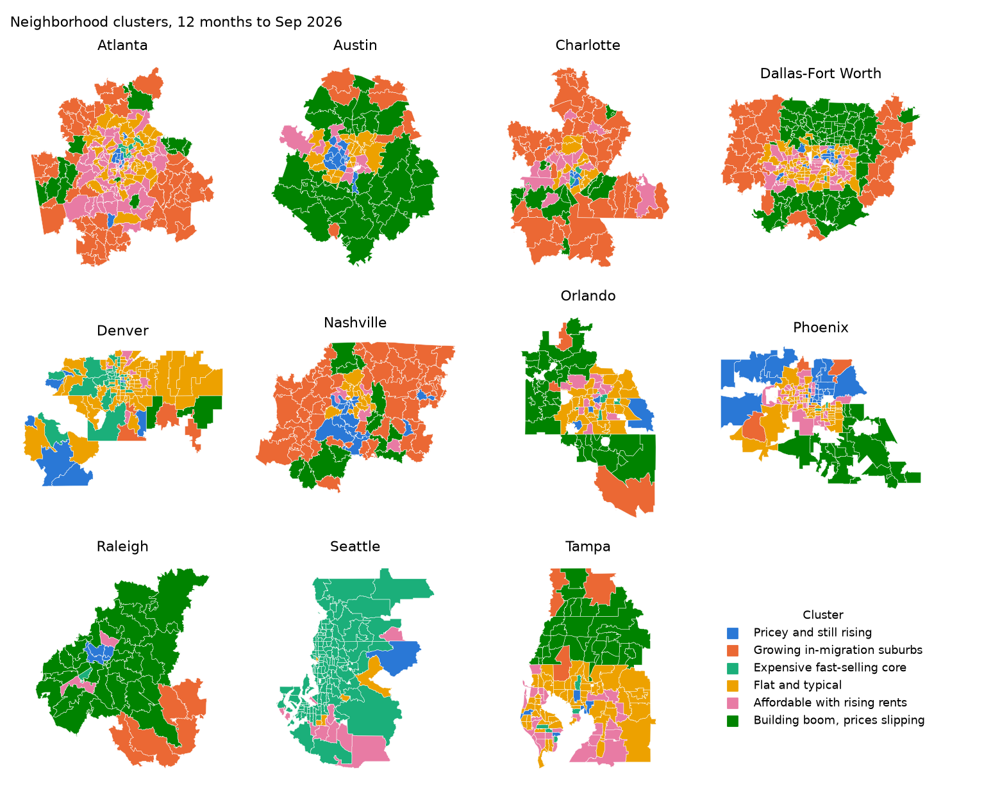
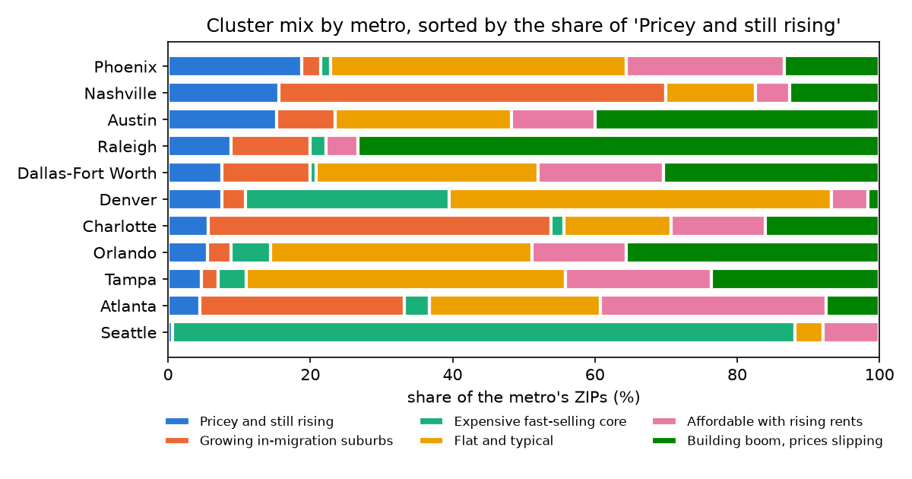

# Neighborhood clusters (Phase 13)

Which kinds of neighborhood does each metro have, and how have ZIPs moved between them since 2019? This page groups
the study ZIPs by their last 12 months of market data. The code is [`ml/clusters.py`](../ml/clusters.py); rerun it
with `uv run --group ml --group dev python -m ml.clusters` after a pipeline run (the warehouse must not be open
elsewhere), then update the numbers and reread the names here. The labels are in the warehouse table
`ml.zip_clusters`.

**Answer:** six clusters, from "pricey and still rising" to "building boom, prices slipping". The groups are readable
but not sharply separated (silhouette 0.18), so treat a ZIP's label as its nearest type, not a hard category. Only
37% of ZIPs are in the same cluster as in December 2019: the pandemic-era in-migration suburbs split between the
building-boom group and flat, typical ZIPs.

## Method

- **Window:** the 12 months to September 2026, from `gold.mart_zip_month`. 1,424 ZIPs with a ZHVI and all four
  required measures.
- **Measures:** 12-month ZHVI growth at the window end (%), average price-to-income, permits per 1,000 residents at the
  window end, average median days on market, 12-month ZORI growth at the window end (%), average net migration per
  1,000. Rent growth is missing for 28% of ZIPs and days on market for a few; a missing value takes the ZIP's metro
  median, and `rent_imputed` / `dom_imputed` flag it.
- **Scaling:** each measure is clipped to its 1st–99th percentile, then standardized.
- **Clustering:** k-means (20 starts, seed 42) for k = 3 to 8. Clusters are numbered by median price growth, highest
  first. A Gaussian mixture with the same k is the cross-check, scored by its adjusted Rand agreement with k-means.
- **2019:** the December 2019 window is scaled with the 2026 clip bounds and scaler and assigned to the nearest 2026
  centroid, so both years use the same cluster definitions.

| k | Silhouette | Gaussian mixture agreement (adjusted Rand) |
| --- | --- | --- |
| 3 | **0.185** | 0.343 |
| 4 | 0.184 | 0.329 |
| 5 | 0.170 | 0.302 |
| 6 | 0.177 | 0.259 |
| 7 | 0.169 | 0.295 |
| 8 | 0.163 | 0.206 |

Every silhouette is weak (0.16–0.19): ZIPs sit on a continuum rather than in tight groups, and the mixture model
agrees with k-means only partly. The score barely separates the options, so k was chosen for readability. k = 3 and 4
merge the building-boom and in-migration groups, which behave differently on prices. k = 6 keeps them apart, gives
each group a distinct profile, and scores close to the best. k = 7 and 8 add groups that differ only in degree.

## The six clusters

Medians per cluster (z-scores of the medians against all ZIPs drive the names):

| # | Name | ZIPs | Growth % | Price/income | Permits /1,000 | Days on market | Rent growth % | Net migration /1,000 |
| --- | --- | --- | --- | --- | --- | --- | --- | --- |
| 0 | Pricey and still rising | 116 | 2.4 | 7.0 | 6.2 | 64 | 1.5 | −1.0 |
| 1 | Growing in-migration suburbs | 221 | 1.5 | 4.4 | 7.4 | 81 | 2.1 | 15.3 |
| 2 | Expensive fast-selling core | 190 | −1.1 | 6.3 | 4.7 | 25 | 2.3 | −4.0 |
| 3 | Flat and typical | 398 | −1.3 | 4.7 | 5.2 | 55 | 0.3 | −0.8 |
| 4 | Affordable with rising rents | 227 | −1.3 | 4.2 | 5.7 | 58 | 3.4 | −0.2 |
| 5 | Building boom, prices slipping | 272 | −2.0 | 4.2 | 11.9 | 68 | 1.2 | 19.3 |

- **0 Pricey and still rising:** the highest price-to-income and the only clear price growth; little building, no
  net in-migration.
- **1 Growing in-migration suburbs:** affordable, strong in-migration and prices still up, with slow sales.
- **2 Expensive fast-selling core:** high prices that have stopped rising, homes sell in under a month, people leave.
- **3 Flat and typical:** near the median on everything; prices slightly down and rents flat.
- **4 Affordable with rising rents:** cheap to buy, with the fastest rent growth of any group.
- **5 Building boom, prices slipping:** about twice the typical permit rate and the most in-migration, yet the steepest price
  declines: new supply is outpacing demand.

## Share by metro

Share of each metro's ZIPs in each cluster (%):

| Metro | 0 | 1 | 2 | 3 | 4 | 5 |
| --- | --- | --- | --- | --- | --- | --- |
| Atlanta | 5 | 29 | 4 | 24 | 32 | 8 |
| Austin | 15 | 8 | 0 | 25 | 12 | 40 |
| Charlotte | 6 | 48 | 2 | 15 | 13 | 16 |
| Dallas-Fort Worth | 8 | 12 | 1 | 31 | 18 | 30 |
| Denver | 8 | 3 | 29 | 54 | 5 | 2 |
| Nashville | 16 | 54 | 0 | 13 | 5 | 13 |
| Orlando | 6 | 3 | 6 | 37 | 13 | 36 |
| Phoenix | 19 | 3 | 1 | 42 | 22 | 13 |
| Raleigh | 9 | 11 | 2 | 0 | 4 | 73 |
| Seattle | 1 | 0 | 87 | 4 | 8 | 0 |
| Tampa | 5 | 2 | 4 | 45 | 20 | 24 |

Raleigh (73%) and Austin (40%) are the building-boom metros; Nashville and Charlotte are mostly growing in-migration
suburbs; Seattle is almost entirely the expensive fast-selling core; Denver, Phoenix and Tampa are mostly flat.

## Moves since December 2019

ZIPs by cluster in the 12 months to December 2019 (rows) and to September 2026 (columns); 1,403 ZIPs have both:

| 2019 \ 2026 | 0 | 1 | 2 | 3 | 4 | 5 | All |
| --- | --- | --- | --- | --- | --- | --- | --- |
| 0 Pricey and still rising | **59** | 0 | 66 | 58 | 17 | 3 | 203 |
| 1 Growing in-migration suburbs | 22 | **193** | 7 | 97 | 61 | 209 | 589 |
| 2 Expensive fast-selling core | 5 | 0 | **72** | 23 | 4 | 0 | 104 |
| 3 Flat and typical | 1 | 0 | 0 | **12** | 4 | 0 | 17 |
| 4 Affordable with rising rents | 25 | 14 | 45 | 200 | **135** | 8 | 427 |
| 5 Building boom, prices slipping | 1 | 4 | 0 | 7 | 4 | **47** | 63 |
| All | 113 | 211 | 190 | 397 | 225 | 267 | 1,403 |

37% stayed in the same cluster. In 2019 prices were rising almost everywhere, so few ZIPs were flat (17) and many
were growing in-migration suburbs (589). Since then, 209 of those suburbs became building-boom ZIPs with falling
prices and 97 went flat; 200 affordable ZIPs went flat; and a third of the 2019 "pricey and still rising" ZIPs became
the expensive fast-selling core, still dear but no longer rising.

## Limits

- **Weak separation:** silhouettes near 0.18 and partial mixture agreement mean the borders between clusters are
  soft. ZIPs near a border can switch with a small data change.
- **Metro effects:** cluster 2 is 87% Seattle ZIPs, so it partly encodes Seattle's fast market rather than a
  neighborhood type found everywhere.
- **County-level migration:** IRS migration is by county, spread to ZIPs by weight, so every ZIP in a county shares
  its rate. That draws large contiguous blocks into clusters 1 and 5, visible on the Raleigh and Nashville maps.
- **Imputation:** rent growth is the metro median for 28% of ZIPs, which pulls those ZIPs toward the middle on rent.
- **Look-ahead:** the marts apply ACS income from its reference year, before it was released. That is fine for a
  descriptive grouping of the past, and the forecast work uses the point-in-time features instead.
- **2019 projection:** 2019 ZIPs are forced onto 2026's centroids. Groups that existed only in 2019 would not appear.
