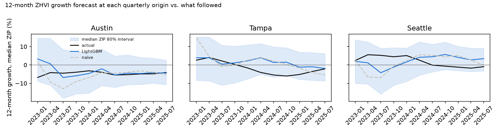

# Forecast backtest (Phase 12)

How well can 12-month home value growth be forecast for a ZIP? This page compares a global LightGBM model with
simple baselines in a rolling-origin backtest on data through September 2026. The code is
[`ml/forecast.py`](../ml/forecast.py); rerun it with `uv run --group ml --group dev python -m ml.forecast` after a
pipeline run, then update the numbers here.

**Answer:** LightGBM beats the naive baseline on the test period, but only just: 3.63 against 3.68 percentage points
of mean absolute error. A plain no-change forecast (2.84) and metro AutoETS (3.15) both beat it. LightGBM is the best
model at ranking ZIPs within their metro; it loses on the metro-wide level, where 2024–2025 brought a turn that
none of its training years showed.

## Setup

- **Target:** ZHVI growth from month t to t + 12 for each study ZIP (`target_growth_12m` in
  [`ml.features_zip_month`](warehouse_design.md#features-ml)).
- **Rolling origin:** one origin per quarter, January 2022 to July 2025. At origin t every model is refit on what was
  published by t's prediction date: LightGBM on the feature rows whose outcome was already known (month ≤ t − 12,
  an expanding window from 2016), AutoETS on the metro series up to t. Each model then forecasts every ZIP with a
  known outcome in month t (about 1,430 ZIPs per origin). Origins in 2022 only warm up the intervals; 2023 origins
  are the validation period and 2024–2025 origins the test period (7 origins, 10,052 forecasts).
- **Models:**
  - *Naive:* last year's growth continues (`zhvi_growth_12m`).
  - *Seasonal naive:* the value 12 months ahead equals the value 12 months back from it, which for a 12-month horizon
    is today's value: no change. ZHVI is seasonally adjusted, so this is the same as a random walk.
  - *AutoETS per metro* (`statsforecast`, season length 12): fit on each metro's monthly ZHVI, and its metro growth
    is given to every ZIP in the metro.
  - *LightGBM:* one global model over all ZIPs and 26 features (cbsa_code as a category), fixed parameters
    (600 rounds, learning rate 0.03, 31 leaves, seed 42). No tuning.

## Results

ZIP-level MAE of 12-month growth, in percentage points (lower is better):

| Metro | LightGBM | Naive | No change | Metro ETS |
| --- | --- | --- | --- | --- |
| Atlanta | 4.21 | 4.14 | **2.81** | 3.26 |
| Austin | **1.89** | 2.54 | 4.55 | 2.66 |
| Charlotte | 3.54 | 3.54 | **2.05** | 2.44 |
| Dallas-Fort Worth | 2.99 | 3.31 | 2.97 | **2.78** |
| Denver | 3.03 | 2.79 | 2.44 | **2.27** |
| Nashville | 2.41 | 2.51 | 2.37 | **2.32** |
| Orlando | 4.20 | 4.09 | **2.82** | 3.14 |
| Phoenix | 3.87 | 3.89 | **2.43** | 2.74 |
| Raleigh | 2.98 | 3.08 | **1.67** | 1.94 |
| Seattle | 4.63 | 4.50 | **2.35** | 5.58 |
| Tampa | 5.13 | 5.09 | 4.40 | **4.15** |
| **All (test, 2024–2025)** | 3.63 | 3.68 | **2.84** | 3.15 |
| All (validation, 2023) | **3.16** | 5.46 | 3.39 | 3.82 |

LightGBM beats naive in 6 of 11 metros on test (Charlotte by under 0.01), and every model in Austin. In validation it beat every baseline.

### Why LightGBM does not win the test period

Each error splits into a metro-wide part (the metro-month average forecast against the average outcome) and a
within-metro part (each ZIP's gap from its metro average):

| Test, 2024–2025 | Metro-wide part | Within-metro part |
| --- | --- | --- |
| LightGBM | 3.37 | **1.57** |
| Naive | 3.31 | 1.74 |
| No change | **2.23** | 1.78 |
| Metro ETS | 2.57 | 1.78 |

LightGBM ranks ZIPs within their metro better than any baseline. Its loss is metro-wide: the median ZIP went from
+0.9% growth (forecast from January 2024) to −2.8% (from October 2024), while the model kept forecasting gains of
about 2–4% from the April to October 2024 origins. The training years (2016–2023 outcomes) are almost all growth, with
one sharp 2022–2023 dip, so the model had seen no slow, flat-to-falling market. No change happened to fit 2024–2025's
mild declines.

The mortgage rate carries 72% of the final model's split gain. It is one national number per month, so in an
expanding window it largely stands in for the period. A check after the main run compared three versions on the same
origins:

| Mortgage feature | Validation MAE | Test MAE |
| --- | --- | --- |
| Rate level (the model above) | 3.16 | **3.63** |
| None | 6.25 | 6.58 |
| 12-month change in the rate | **2.92** | 5.57 |

The other two rows were run before a row-order fix that moved the main model's MAE by up to 0.06; the gaps are far larger. Dropping the rate makes everything worse, so rates matter. Validation prefers the 12-month change, which then does far
worse on test. Choosing by validation would have picked the worse model; the reported model stays the one fixed before
any test result was seen. One validation year cannot pick features across market regimes.

### Metro level

AutoETS against naive on each metro's own series, origins from 2024 (MAE in percentage points):

| Metro | ZHVI ETS | ZHVI naive | ZORI ETS | ZORI naive |
| --- | --- | --- | --- | --- |
| Atlanta | **2.55** | 3.48 | **1.10** | 1.16 |
| Austin | 2.48 | **1.69** | 1.24 | **1.14** |
| Charlotte | **1.70** | 2.53 | **0.67** | 0.72 |
| Dallas-Fort Worth | **2.32** | 2.52 | **0.53** | 0.55 |
| Denver | **1.98** | 2.49 | **1.75** | 2.15 |
| Nashville | **1.09** | 1.54 | **0.41** | 0.52 |
| Orlando | **3.22** | 3.90 | **0.41** | 0.68 |
| Phoenix | **2.40** | 3.38 | 0.81 | **0.78** |
| Raleigh | **1.88** | 2.53 | 0.67 | **0.58** |
| Seattle | 5.57 | **4.35** | **0.64** | 0.74 |
| Tampa | **3.79** | 4.65 | **2.11** | 2.18 |

ETS beats naive for ZHVI in 9 of 11 metros and for rent (ZORI) in 8. Rent forecasts are only metro level: ZORI
is missing for 31–57% of ZIP-months, depending on the period, too many for a ZIP model. Seattle is ETS's worst
metro.

## Prediction intervals

The 80% intervals use conformalized quantile regression (CQR): two more LightGBM models predict the 10th and 90th
percentiles, and each origin widens that band by the 80% quantile of earlier misses whose outcome was known by then
(origins at least 12 months back).

| Test, 2024–2025 | Coverage (target 80%) | Mean width |
| --- | --- | --- |
| Quantile models alone | 32% | 4.3 pp |
| After CQR | 94% | 15.6 pp |

The quantile models alone are far too narrow, the same regime problem as above. CQR restores coverage, but it
calibrates on 2022–2023 misses, which were larger, so it over-covers and the band is too wide to be useful for a
single ZIP. The metro AutoETS intervals cover 87% of metro outcomes (ZHVI and ZORI) at a nominal 80%.

## Forecast vs. actual

Median ZIP in three metros: the forecast made at each quarterly origin against the growth that followed. The band is
the median ZIP's 80% interval bound after CQR.

- **Austin:** the clearest win. After a 2022 crash, naive forecast another −13% from mid-2023, but values fell only
  about 4–5%. LightGBM tracked the outcome from mid-2024 on.
- **Tampa:** the biggest miss. LightGBM forecast +1% to +4% from the 2024 origins, and values fell 4–6%. Nothing in the
  features anticipated the Florida-wide decline; insurance costs, often cited for it, are not in the data.
- **Seattle:** LightGBM was too low in 2023 (it forecast −4% from July 2023; values rose 5%) and too high in 2024–2025
  (+4% to +6% forecast against 0% to −2%). In both cases it followed recent metro momentum one turn too long.

## Limits

- Zillow restates past months, and the warehouse keeps only the latest release, so the backtest's inputs are a little
  cleaner than they were live.
- Each origin's forecasts share one 12-month future, so the 7 test origins are far from independent samples; one
  more year of data could reorder the models.
- No tuning: parameters were fixed before the backtest. The feature check above shows why tuning on one validation
  year would not be trusted anyway.
- Since Phase 15 the model is refit and scored monthly into `ml.predictions` by `ml/train.py`; see the
  [model card](model_card.md).

## Takeaways for later phases

- For the metro-wide level, a no-change or ETS forecast is the honest default; LightGBM's value is the ranking within
  a metro. Phase 14's classifier (top 20% of growth within the metro) targets exactly that.
- Phase 15 could publish ZIP forecasts as the metro ETS path plus LightGBM's within-metro offset, and show intervals
  only at the metro level until the ZIP intervals narrow.
