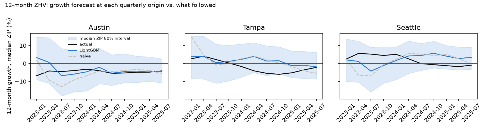

# Forecast backtest (Phase 12)

How well can 12-month home value growth be forecast for a ZIP? This page compares a global LightGBM model with
simple baselines in a rolling-origin backtest on data through September 2026. The code is
[`ml/forecast.py`](../ml/forecast.py); rerun it with `uv run --group ml --group dev python -m ml.forecast` after a
pipeline run, then update the numbers here.

**Answer:** LightGBM beats the naive baseline on the test period, but only just: 3.63 against 3.68 percentage points
of mean absolute error. A plain no-change forecast (2.84) and metro AutoETS (3.15) both beat it. LightGBM is the best
model at ranking ZIPs within their metro; it loses on the metro-wide level, where 2024–2025 brought a turn that
none of its training years showed. Taking the metro level from AutoETS and the ZIP spread from LightGBM cuts the test
error to 2.93, ahead of both parents but still behind no change, and it gives up LightGBM's validation lead.

## Setup

- **Target:** ZHVI growth from month t to t + 12 for each study ZIP (`target_growth_12m` in
  [`ml.features_zip_month`](warehouse_design.md#features-ml)).
- **Rolling origin:** one origin per quarter, January 2022 to July 2025. At origin t every model is refit on what was
  published by t's prediction date: LightGBM on the feature rows whose outcome was already known (month ≤ t − 12,
  an expanding window from 2016), AutoETS on the metro series up to t. Each model then forecasts every ZIP with a
  known outcome in month t (about 1,430 ZIPs per origin). Origins in 2022 only warm up the intervals; 2023 origins
  are the validation period and 2024–2025 origins the test period (7 origins, 10,052 forecasts).
- **Models:**
  - *Naive:* last year's growth continues (`zhvi_growth_12m`).
  - *Seasonal naive:* the value 12 months ahead equals the value 12 months back from it, which for a 12-month horizon
    is today's value: no change. ZHVI is seasonally adjusted, so this is the same as a random walk.
  - *AutoETS per metro* (`statsforecast`, season length 12): fit on each metro's monthly ZHVI, and its metro growth
    is given to every ZIP in the metro.
  - *LightGBM:* one global model over all ZIPs and 26 features (cbsa_code as a category), fixed parameters
    (600 rounds, learning rate 0.03, 31 leaves, seed 42). No tuning.
  - *Reconciled:* LightGBM's ZIP forecasts shifted, per metro and origin, so their ZHVI-weighted mean equals the AutoETS
    metro forecast. It keeps LightGBM's spread within the metro and takes the level from ETS.

## Results

ZIP-level MAE of 12-month growth, in percentage points (lower is better):

| Metro | LightGBM | Naive | No change | Metro ETS | Reconciled |
| --- | --- | --- | --- | --- | --- |
| Atlanta | 4.21 | 4.14 | **2.81** | 3.26 | 2.85 |
| Austin | **1.89** | 2.54 | 4.55 | 2.66 | 2.42 |
| Charlotte | 3.54 | 3.54 | **2.05** | 2.44 | 2.40 |
| Dallas-Fort Worth | 2.99 | 3.31 | 2.97 | 2.78 | **2.48** |
| Denver | 3.03 | 2.79 | 2.44 | 2.27 | **2.16** |
| Nashville | 2.41 | 2.51 | 2.37 | 2.32 | **1.93** |
| Orlando | 4.20 | 4.09 | **2.82** | 3.14 | 2.99 |
| Phoenix | 3.87 | 3.89 | **2.43** | 2.74 | 2.63 |
| Raleigh | 2.98 | 3.08 | **1.67** | 1.94 | 1.75 |
| Seattle | 4.63 | 4.50 | **2.35** | 5.58 | 5.30 |
| Tampa | 5.13 | 5.09 | 4.40 | 4.15 | **4.08** |
| **All (test, 2024–2025)** | 3.63 | 3.68 | **2.84** | 3.15 | 2.93 |
| All (validation, 2023) | **3.16** | 5.46 | 3.39 | 3.82 | 3.79 |

LightGBM beats naive in 6 of 11 metros on test (Charlotte by under 0.01), and every model in Austin. In validation it beat every baseline.

Reconciled beats both parents on test in 9 of 11 metros (LightGBM stays ahead in Austin and Seattle) and has the
lowest error in 4, but it does not beat no change overall, and in validation it barely beats ETS. It inherits ETS's
misses, most visibly Seattle. In a one-off check the weights mattered about as much as the gap to no change: equal
weights give 2.99 on test and 3.86 on validation, and ZHVI × population, closer to total housing value, gives 3.02 and
3.72. The ZHVI weights were chosen before any result was seen. The production forecast stays LightGBM, since no version
wins both periods.

### Why LightGBM does not win the test period

Each error splits into a metro-wide part (the metro-month average forecast against the average outcome) and a
within-metro part (each ZIP's gap from its metro average):

| Test, 2024–2025 | Metro-wide part | Within-metro part |
| --- | --- | --- |
| LightGBM | 3.37 | **1.57** |
| Naive | 3.31 | 1.74 |
| No change | **2.23** | 1.78 |
| Metro ETS | 2.57 | 1.78 |
| Reconciled | 2.50 | **1.57** |

LightGBM ranks ZIPs within their metro better than any baseline. Its loss is metro-wide: the median ZIP went from
+0.9% growth (forecast from January 2024) to −2.8% (from October 2024), while the model kept forecasting gains of
about 2–4% from the April to October 2024 origins. The training years (2016–2023 outcomes) are almost all growth, with
one sharp 2022–2023 dip, so the model had seen no slow, flat-to-falling market. No change happened to fit 2024–2025's
mild declines.

The mortgage rate carries 72% of the final model's split gain. It is one national number per month, so in an
expanding window it largely stands in for the period. A check after the main run compared three versions on the same
origins:

| Mortgage feature | Validation MAE | Test MAE |
| --- | --- | --- |
| Rate level (the model above) | 3.16 | **3.63** |
| None | 6.25 | 6.58 |
| 12-month change in the rate | **2.92** | 5.57 |

The other two rows were run before a row-order fix that moved the main model's MAE by up to 0.06; the gaps are far larger. Dropping the rate makes everything worse, so rates matter. Validation prefers the 12-month change, which then does far
worse on test. Choosing by validation would have picked the worse model; the reported model stays the one fixed before
any test result was seen. One validation year cannot pick features across market regimes.

Monthly metro payrolls (BLS CES total nonfarm, via FRED) were tested as two more features: growth over 3 and 12
months, each as published by the prediction date (two months after the month). The check reran the 15 quarterly
origins from 2022 with seeds 42 and 1:

| Origins (30 origin-seed pairs) | Without payrolls | With payrolls |
| --- | --- | --- |
| 2022 | **7.34** | 8.10 |
| 2023 | 3.05 | **3.04** |
| 2024 | **4.23** | 4.33 |
| 2025 | 2.92 | 2.92 |
| All | **4.48** | 4.71 |

Payrolls helped at 9 of 30 origin-seed pairs and added 0.23 points of MAE on average (standard error 0.07), most of it
in 2022, so they are not features. The hot-ZIP classifier moved by about its seed-to-seed noise: on the test months,
precision in each metro's top 20% went from 0.404 to 0.407 and PR-AUC from 0.344 to 0.347; on the validation months,
precision among the top 20 a month fell from 0.458 to 0.450. The payrolls stay in the warehouse
(`payroll_jobs_thousands` in `mart_metro_month`) as a monthly view of jobs between QCEW's quarterly counts.

### Metro level

AutoETS against naive on each metro's own series, origins from 2024 (MAE in percentage points):

| Metro | ZHVI ETS | ZHVI naive | ZORI ETS | ZORI naive |
| --- | --- | --- | --- | --- |
| Atlanta | **2.55** | 3.48 | **1.10** | 1.16 |
| Austin | 2.48 | **1.69** | 1.24 | **1.14** |
| Charlotte | **1.70** | 2.53 | **0.67** | 0.72 |
| Dallas-Fort Worth | **2.32** | 2.52 | **0.53** | 0.55 |
| Denver | **1.98** | 2.49 | **1.75** | 2.15 |
| Nashville | **1.09** | 1.54 | **0.41** | 0.52 |
| Orlando | **3.22** | 3.90 | **0.41** | 0.68 |
| Phoenix | **2.40** | 3.38 | 0.81 | **0.78** |
| Raleigh | **1.88** | 2.53 | 0.67 | **0.58** |
| Seattle | 5.57 | **4.35** | **0.64** | 0.74 |
| Tampa | **3.79** | 4.65 | **2.11** | 2.18 |

ETS beats naive for ZHVI in 9 of 11 metros and for rent (ZORI) in 8. Rent forecasts are only metro level: ZORI
is missing for 31–57% of ZIP-months, depending on the period, too many for a ZIP model. Seattle is ETS's worst
metro.

## Prediction intervals

The 80% intervals use conformalized quantile regression (CQR): two more LightGBM models predict the 10th and 90th
percentiles, and each origin widens that band by the 80% quantile of earlier misses whose outcome was known by then
(origins at least 12 months back).

| Test, 2024–2025 | Coverage (target 80%) | Mean width |
| --- | --- | --- |
| Quantile models alone | 32% | 4.3 pp |
| After CQR | 94% | 15.6 pp |

The quantile models alone are far too narrow, the same regime problem as above. CQR restores coverage, but it
calibrates on 2022–2023 misses, which were larger, so it over-covers and the band is too wide to be useful for a
single ZIP. The metro AutoETS intervals cover 87% of metro outcomes (ZHVI and ZORI) at a nominal 80%.

## Forecast vs. actual

Median ZIP in three metros: the forecast made at each quarterly origin against the growth that followed. The band is
the median ZIP's 80% interval bound after CQR.

- **Austin:** the clearest win. After a 2022 crash, naive forecast another −13% from mid-2023, but values fell only
  about 4–5%. LightGBM tracked the outcome from mid-2024 on.
- **Tampa:** the biggest miss. LightGBM forecast +1% to +4% from the 2024 origins, and values fell 4–6%. Nothing in the
  features anticipated the Florida-wide decline; insurance costs, often cited for it, are not in the data, and FEMA's
  county risk index does not explain it ([findings Q10](findings.md#q10-does-climate-risk-explain-the-tampa-and-orlando-declines)).
- **Seattle:** LightGBM was too low in 2023 (it forecast −4% from July 2023; values rose 5%) and too high in 2024–2025
  (+4% to +6% forecast against 0% to −2%). In both cases it followed recent metro momentum one turn too long.

## Turning points

Can the metro-wide turn be called in advance? [`ml/turning_points.py`](../ml/turning_points.py) is a separate,
backtest-only model of whether a metro's ZHVI will be lower 12 months on, from
[`ml.features_metro_month`](../dbt/models/ml/_ml.yml). Each quarter is an origin; logistic regressions see only outcomes
published by then, and origins start once training holds a decline (April 2023 to July 2025). That gives 110
metro-quarters, 73 of them followed by a decline (66%). They are far from independent: 11 metros, 10 origins and one
national cycle.

The models add to each other: 12-month growth alone, then the 12-month change in the mortgage rate (not its level),
then Realtor.com's year-on-year listings, price cuts and days on market. Persistence is the simple baseline: what is
falling now stays falling. "Turns" keeps the 57 rows still growing at the origin, 37 of them followed by a decline.

| Rows | Model | AUC within origin | Brier | Precision at 0.5 | Recall at 0.5 |
| --- | --- | --- | --- | --- | --- |
| All | Persistence | 0.670 | 0.491 | 0.679 | 0.493 |
| All | Growth | 0.173 | 0.587 | none called | 0 |
| All | Growth + rates | 0.173 | 0.631 | none called | 0 |
| All | Growth + rates + Realtor.com | 0.475 | 0.614 | none called | 0 |
| Turns | Persistence | 0.500 | 0.649 | none called | 0 |
| Turns | Growth | 0.448 | 0.589 | none called | 0 |
| Turns | Growth + rates | 0.448 | 0.633 | none called | 0 |
| Turns | Growth + rates + Realtor.com | 0.647 | 0.632 | none called | 0 |

AUC ranks the metros inside each origin with both outcomes: 5 origins for all rows, 2 for turns. The mortgage rate is
one national number, so it cannot change that ranking. A constant forecast of 0.5 would score a Brier of 0.25.

**No model works as a warning.** None of the regressions called a single one of the 73 declines at 0.5. Persistence
called 53 and was right on 36, a precision of 0.68 against a 66% base rate. Every model's Brier is worse than the
constant's.

The likely reason is that the only earlier decline in the data looks unlike the next one. Declines enter training from
early 2023, all from the 2022 rate shock. In the April 2023 fit, higher growth and rising rates both push the score up.
The 2024-2025 declines came with much slower growth and little change in rates, and the mean score at each origin stays
at 0.15 or below through July 2025. The positive coefficient on growth also fits the growth model's AUC of 0.17, which is worse than chance.

Realtor.com improves the ranking on turns (0.647 against 0.448), but on 2 origins and 57 rows that is not evidence.
Three checks, none in the repo, did not change the conclusion: balancing the class weights (at most one correct call),
dropping rows Realtor.com flags from training (one correct call) and dropping Nashville's distorted rows from training
(no calls). The model stays out of the monthly run. It would need a second full housing cycle, or many more metros,
to train on more than one kind of decline.

## Limits

- Zillow restates past months, and the warehouse keeps only the latest release, so the backtest's inputs are a little
  cleaner than they were live.
- Each origin's forecasts share one 12-month future, so the 7 test origins are far from independent samples; one
  more year of data could reorder the models.
- No tuning: parameters were fixed before the backtest. The feature check above shows why tuning on one validation
  year would not be trusted anyway.
- Since Phase 15 the model is refit and scored monthly into `ml.predictions` by `ml/train.py`; see the
  [model card](model_card.md).

## Takeaways for later phases

- For the metro-wide level, a no-change or ETS forecast is the honest default; LightGBM's value is the ranking within
  a metro. Phase 14's classifier (top 20% of growth within the metro) targets exactly that.
- Phase 15 could publish ZIP forecasts as the metro ETS path plus LightGBM's within-metro offset, and show intervals
  only at the metro level until the ZIP intervals narrow.
