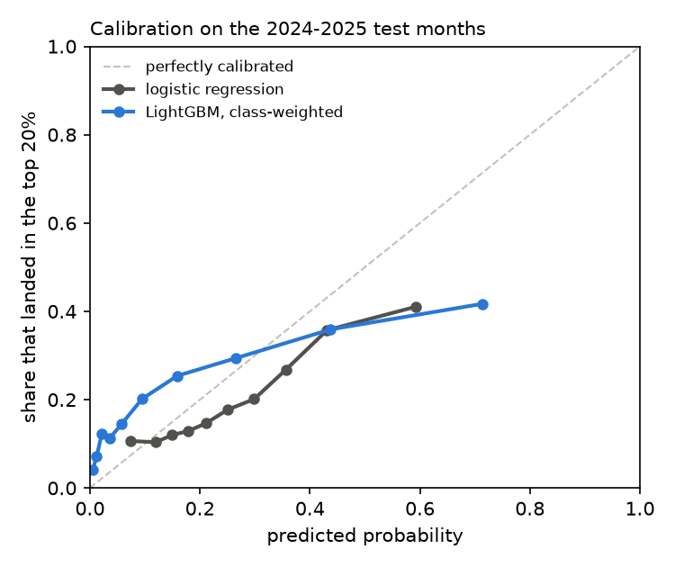
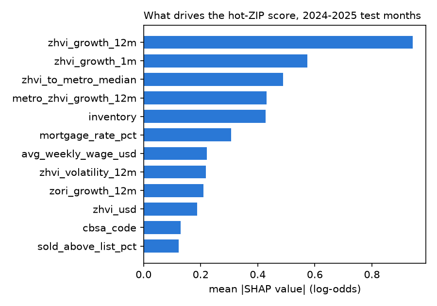
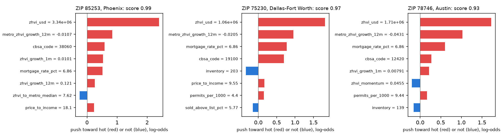

# Hot-ZIP classifier (Phase 14)

Can we tell ahead of time which ZIPs will land in their metro's top 20% of home value growth over the next 12 months?
This page compares a momentum baseline, logistic regression and LightGBM on held-out months, explains the LightGBM
scores with SHAP, and lists the ZIPs flagged as of September 2026. The code is [`ml/hot_zips.py`](../ml/hot_zips.py);
rerun it with `uv run --group ml --group dev python -m ml.hot_zips` after a pipeline run, then update the numbers
here. The scores are in the warehouse table `ml.hot_zips`.

> **Read this first.** The model describes market signals in public aggregate data. It is not investment advice, and
> a flag is a ranking, not a promise: on the test months fewer than half of the flagged ZIPs actually landed in the
> top 20%. Fast price growth is not good news for everyone. In a neighborhood where prices climb fastest, renters and
> long-time owners on fixed incomes often face rising rents and property taxes, and many are displaced. A "hot" ZIP
> is as much a warning about affordability as a signal about demand.

**Answer:** yes, clearly better than chance, but not by much more than momentum. On the 2024–2025 test months,
42–51% of flagged ZIPs landed in the top 20%, against a 20% base rate. Simply ranking ZIPs by last year's growth
gets 44–46%. LightGBM has the best PR-AUC (0.347), logistic regression the best precision among the top 20 ZIPs a
month (0.514), and the momentum baseline the best precision within metros (0.443).

## Setup

- **Target:** `target_top20` in [`ml.features_zip_month`](warehouse_design.md#features-ml), true when a ZIP's ZHVI
  growth from month t to t + 12 is in the top 20% of its metro's ZIPs that month.
- **Features:** the same 26 point-in-time features as the [forecast](forecast_report.md), each as published by the
  row's prediction date.
- **Time split:** each model is trained once per period on rows whose outcome was published before the period
  began: rows known by January 2023 (months up to January 2022) for the 2023 validation months, and rows known by
  January 2024 for the 21 test months, January 2024 to September 2025 (30,156 ZIP-months). The test model is not
  refit as the test period goes on.
- **Models:**
  - *Momentum baseline:* rank by last year's ZHVI growth (`zhvi_growth_12m`); ZIPs with under a year of history get
    their metro's median.
  - *Logistic regression:* median imputation, standardization, no class weights (`scikit-learn`).
  - *LightGBM:* the forecast's fixed parameters with a binary objective and the positive class weighted 4:1
    (`scale_pos_weight`), with `cbsa_code` as a category. No tuning.
- **Flags:** a ZIP is flagged when its score is in the top 20% of its metro's ZIPs that month, so every metro has the
  same share flagged as the base rate.

## Results

| Period | Model | Precision, top 20 ZIPs a month | Precision, top 20% per metro | PR-AUC |
| --- | --- | --- | --- | --- |
| Validate (2023) | Momentum | 0.217 | 0.300 | 0.225 |
| | Logistic regression | 0.358 | **0.322** | 0.273 |
| | LightGBM | **0.458** | 0.303 | **0.289** |
| Test (2024–2025) | Momentum | 0.455 | **0.443** | 0.301 |
| | Logistic regression | **0.514** | 0.412 | 0.338 |
| | LightGBM | 0.469 | 0.410 | **0.347** |
| Both | Base rate | 0.200 | 0.200 | 0.200 |

"Top 20 ZIPs a month" takes the 20 highest scores across all metros each month and averages the share that landed
in their metro's top 20%. "Top 20% per metro" flags each metro's top fifth, the rule used for publishing.

Every model beats the 20% base rate on every measure in both periods; the models gain little over momentum.
Momentum was weak in 2023 (0.217), when the 2022 price turn made last year's leaders a poor guide, and strong in
2024–2025, so its usefulness swings with the market. The models are steadier across both periods.

LightGBM precision within metros on the test months ranges from 0.25 (Tampa) and 0.28 (Charlotte) to 0.50 (Atlanta)
and 0.51 (Phoenix):

| Metro | Precision | Metro | Precision |
| --- | --- | --- | --- |
| Atlanta | 0.501 | Nashville | 0.465 |
| Austin | 0.476 | Orlando | 0.423 |
| Charlotte | 0.277 | Phoenix | 0.511 |
| Dallas-Fort Worth | 0.406 | Raleigh | 0.365 |
| Denver | 0.429 | Seattle | 0.352 |
| | | Tampa | 0.245 |

**Calibration:** neither model's scores are probabilities. Class weighting pushes LightGBM's scores up, and both
models are overconfident at the top: of the test ZIP-months LightGBM scored around 0.7, about 42% landed in the top
20%. Read a score as a rank within the metro.

## What drives the score (SHAP)

SHAP values are LightGBM's own TreeSHAP contributions (`pred_contrib=True`), in log-odds. Over the test months, a
ZIP's own recent growth matters most (12-month and 1-month ZHVI growth), then its price relative to the metro median,
the metro's growth, and for-sale inventory. Metro-wide features (`metro_zhvi_growth_12m`, `mortgage_rate_pct`,
`cbsa_code`) take the same value for every ZIP in a metro that month, so they mostly lift or lower a metro's scores
together; the ranking within a metro rests mainly on the ZIP's own features.

The three highest-scored ZIPs, one each in the three metros with the top scores, as of September 2026, scored by the
model trained on all known outcomes:

- **85253 (Paradise Valley, Phoenix), score 0.99:** the price level dominates (a $3.3M ZHVI, +2.39), helped by the
  metro's flat year and recent ZIP growth (12.1% in the last year, 1.0% last month).
- **75230 (North Dallas), score 0.97:** again the $1.06M price level (+1.82) and metro-wide terms; low inventory and a
  low share of homes sold above list pull it down slightly.
- **78746 (West Lake Hills, Austin), score 0.93:** the $1.71M price level (+1.73) and Austin's falling metro prices
  (−4.3%); in this model a falling metro raises the score of its ZIPs.

The top current flags lean on the dollar price level (`zhvi_usd`, +1.7 to +2.4) far more than the average test
ZIP-month (mean |SHAP| 0.19). A likely reason: dollar prices drift up over time, so 2026 values sit at the top of the
training range, where trees give every expensive ZIP the same boost.
Dropping the three dollar-level features (`zhvi_usd`, `zori_usd`, `avg_weekly_wage_usd`) made the test results worse
(PR-AUC 0.312, within-metro precision 0.355), so they stay, but the current flags favor expensive ZIPs.

## ZIPs flagged for the 12 months from September 2026

290 of 1,436 ZIPs are flagged (each metro's top 20%). The five highest scores per metro (the full list is in
`ml.hot_zips`):

| Metro | ZIPs (score) |
| --- | --- |
| Atlanta | 31816 (0.90), 30663 (0.90), 30641 (0.89), 30327 (0.89), 30306 (0.89) |
| Austin | 78746 (0.93), 78703 (0.93), 78733 (0.92), 78731 (0.91), 78650 (0.90) |
| Charlotte | 28207 (0.91), 28211 (0.87), 28101 (0.82), 28209 (0.82), 28226 (0.81) |
| Dallas-Fort Worth | 75230 (0.97), 75205 (0.97), 75225 (0.97), 76092 (0.96), 75214 (0.96) |
| Denver | 80135 (0.89), 80116 (0.88), 80118 (0.82), 80111 (0.81), 80420 (0.80) |
| Nashville | 37046 (0.90), 38560 (0.85), 37145 (0.84), 38552 (0.84), 37137 (0.81) |
| Orlando | 32836 (0.93), 32789 (0.92), 34756 (0.92), 32709 (0.91), 34734 (0.88) |
| Phoenix | 85253 (0.99), 85262 (0.97), 85259 (0.97), 85255 (0.96), 85264 (0.96) |
| Raleigh | 27608 (0.89), 27607 (0.77), 27518 (0.72), 27542 (0.62), 27508 (0.59) |
| Seattle | 98333 (0.82), 98304 (0.81), 98394 (0.76), 98020 (0.73), 98323 (0.71) |
| Tampa | 33548 (0.83), 33629 (0.83), 33527 (0.82), 34688 (0.78), 33618 (0.77) |

## Caveats and limits

- **Not advice:** this is a description of market signals, not a recommendation to buy, sell or invest. See the
  note at the top on displacement.
- **Modest skill:** about 4 in 10 flagged ZIPs land in the top 20% (a 2x lift), and a momentum rank does nearly as
  well. Precision is lowest in Tampa and Charlotte.
- **Scores are not probabilities:** they are overconfident and inflated by class weighting; use the within-metro rank
  (`metro_rank_pct`).
- **Price-level drift:** the current flags rely on the dollar price level, which is past most of the training range
  (see SHAP above).
- **One fit per period, no tuning:** the test model is fit once in January 2024 and not refreshed; the parameters are
  the forecast's, untuned.
- **Restated inputs:** Zillow and Redfin restate history and the warehouse keeps only their latest release, so past
  features are slightly cleaner than they were live (see the feature table's limits).
- **Overlapping outcomes:** consecutive months share most of their 12-month window, so the 21 test months are far
  from 21 independent tests.
