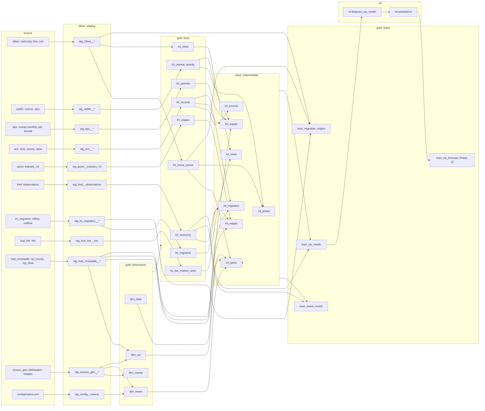

# Warehouse design

How the DuckDB warehouse (`data/warehouse.duckdb`) is laid out, what every model is called, and which grain and month rules the dbt models follow. Source facts (keys, units, quirks) live in the [data dictionary](data_dictionary.md).

## Layers

| Schema | Holds | Built by | Materialized |
| --- | --- | --- | --- |
| `bronze` | One view per bronze entity, `bronze.<source>__<entity>`, over every Parquet load in `data/bronze/<source>/<entity>/`. All columns are text plus `_source_file`, `_load_id`, `_loaded_at`, `_file_hash`. | `python -m ingest` (`register_views` runs at the end of every run) | view |
| `silver` | Staging (`stg_`) and intermediate (`int_`) models: typed, cleaned, conformed to month and geography. | dbt | view (staging), table (intermediate) |
| `gold` | Dimensions (`dim_`), facts (`fct_`) and marts (`mart_`). The dashboard, models and exports read only from here. | dbt | table (`mart_zip_month`: incremental) |
| `ml` | Feature tables built by dbt and predictions written by the training code. | dbt and Python | table |

`main` keeps only `_load_log` (written by ingestion). A `generate_schema_name` macro makes dbt build into the configured schema as is (its default would be `main_silver`).

The bronze views read absolute paths, so they work from any working directory. After moving the repo, rerun `.\tasks.ps1 ingest` to rebuild them; each run drops and recreates the `bronze` schema, so a removed entity leaves no stale view. A bronze view returns every monthly copy of a rolling source (Zillow, Redfin, FRED, HUD crosswalk); staging keeps only the newest `_loaded_at` per source file (the `latest_load()` macro).

## Naming

| Prefix | Schema | Rule | Example |
| --- | --- | --- | --- |
| `stg_<source>__<entity>` | silver | One per source, or per entity when a source's entities differ in layout. Entities with the same layout are unioned with a `geo_level` or `file_type` column. Renames to snake_case, casts types, keeps ZIP and FIPS codes as zero-padded text, keeps the newest load. No joins. | `stg_redfin__market_tracker` |
| `int_<topic>` | silver | One per topic, plus `int_spine`. Takes facts to the two target grains: applies the month rule, rolls counties up to metros, carries county rates to ZIPs. Each returns exactly the `int_spine` rows. | `int_supply` |
| `dim_<entity>` | gold | One row per member. | `dim_zip` |
| `fct_<topic>` | gold | One row per geography per native period. Keeps the source's own grain; no carry-forward. | `fct_permits` |
| `mart_<grain>` | gold | Wide, one row per place per month. | `mart_metro_month` |

Columns are snake_case with the unit in the name when it is not obvious (`value_usd`, `sale_to_list_pct`). Booleans start with `is_`. Every month column is called `month`.

## Target grains

- **`metro_month`**: one row per (`cbsa_code`, `month`) for the 11 study metros in `dim_metro`.
- **`zip_month`**: one row per (`zip`, `month`) for every `dim_zip` ZIP with `is_po_box_only = false`.

Both marts run from 2015-01 (the first month every source covers) through the latest month with a Zillow ZHVI value; `int_spine` holds those rows. Facts keep each source's full history but only the study geographies (study metros, their counties and their ZIPs).

## Month rule

- `month` is a DATE on the first day of the month. Zillow month-end headers, Redfin `PERIOD BEGIN`, BPS `survey_date` and FRED dates all convert to it.
- Redfin ZIP rows are trailing three-month windows; each window is keyed on its `PERIOD END` month. Redfin's monthly files replace the weekly roll-up the plan first named, and the feed has only not-seasonally-adjusted series, so SA and NSA never mix.
- Weekly FRED series (`MORTGAGE30US`) become the mean of the observations dated in the month.
- A quarterly or annual value applies to every month it covers: QCEW Q1 to January through March, an ACS 5-year vintage ending *Y* to the 12 months of *Y*, an IRS pair (*Y*-1, *Y*) to the 12 months of *Y*, HUD FMR fiscal year *Y* to October *Y*-1 through September *Y*.
- Months after the latest published period repeat the latest value and set `<topic>_is_carried_forward = true` (for example `income_is_carried_forward`). The flag is false wherever the value comes from the month's own period. Each mart also carries the source period (`income_acs_vintage`, `wages_quarter`, `migration_tax_year`) so a reader can see how stale a value is.
- Marts align values to their reference period, not their release date. The Phase 11 features apply the release lags in the data dictionary's point-in-time rule.

## Geography rules

- **Metro**: CBSA code from the July 2023 delineation. County data rolls up through `dim_county.cbsa_code`; additive measures (permits, migration counts) are summed.
- **Redfin Dallas-Fort Worth and Seattle**: Redfin reports these as metro divisions (19124 and 23104; 42644 and 45104). Each pair covers the whole CBSA (Seattle's pre-2023 42644 includes Everett). The metro row sums the counts (homes sold, pending sales, new and active listings, inventory) across both divisions and recomputes months of supply from those sums. Medians and percentages are averaged weighted by homes sold and flagged `is_division_blend = true`. They are an approximation; a true metro median would need transaction data.
- **ZIP**: county data reaches a ZIP as the average of its counties' rates or averages (permits per 1,000, net migration rate, average weekly wage), weighted by `stg_hud_crosswalk__zip_county.res_ratio`. County counts (permit units, employment, net migrants) are not split across ZIPs and stay null at ZIP grain. A ZIP takes its metro's unemployment rate. ACS values join through `dim_zip.zcta`.
- **HUD FMR**: a metro takes the area-wide FMR of its core FMR area (the first in `config/metros.yml` `hud_fmr_areas`). A ZIP takes its Small Area FMR when HUD publishes one for that fiscal year, else the metro value. ZIPs in the peripheral single-county FMR areas get the core value (a known shortcut).

## Star schema

### Dimensions (gold)

| Model | Key | Contents |
| --- | --- | --- |
| `dim_date` | `month` | Every month from 2012-01 through the current month: `year`, `quarter`, `month_of_year`, `quarter_start`. |
| `dim_metro` | `cbsa_code` | The 11 study metros and each source's code for them: Zillow region, Redfin regions, QCEW area, FRED unemployment series, HUD FMR areas. |
| `dim_county` | `county_fips` | Every US county with its CBSA, metro division and `is_study_metro` (Phase 3). |
| `dim_zip` | `zip` | Study-metro ZIPs with primary county, CBSA and ZCTA (Phase 3). |

### Facts (gold)

`geo_level` is `zip`, `county` or `metro`; `geo_code` is the ZIP, county FIPS or CBSA code; every fact row also carries `cbsa_code`.

| Model | Grain | Measures | Source |
| --- | --- | --- | --- |
| `fct_home_prices` | (`geo_level`, `geo_code`, `month`); zip and metro | `zhvi_usd` | Zillow ZHVI |
| `fct_rents` | (`geo_level`, `geo_code`, `month`); zip and metro | `zori_usd` | Zillow ZORI |
| `fct_fair_market_rents` | (`fmr_area_code`, `zip`, `fiscal_year`); `zip` null for area-wide FMRs | `fmr_0br_usd` to `fmr_4br_usd`, `is_small_area` | HUD FMR |
| `fct_market_activity` | (`geo_level`, `geo_code`, `month`); zip and metro | `homes_sold`, `pending_sales`, `new_listings`, `active_listings`, `inventory`, `months_of_supply`, `median_days_on_market`, `sale_to_list_pct`, `sold_above_list_pct`, `off_market_in_two_weeks_pct`, `median_sale_price_usd`, `median_sale_ppsf_usd`, `median_list_price_usd`, `median_list_ppsf_usd`, `is_division_blend` | Redfin |
| `fct_permits` | (`county_fips`, `month`) | `units_1`, `units_2`, `units_3_4`, `units_5_plus`, `total_units`, `is_estimated` | BPS monthly; April 2015 from the year-to-date files; annual totals spread over 12 months where the pre-2022 monthly sample lacks the county |
| `fct_wages` | (`geo_level`, `geo_code`, `month`); county (QCEW `agglvl_code` 70) and metro (40) | `employment` (monthly), `avg_weekly_wage_usd`, `total_wages_usd`, `establishments` (quarterly), `quarter` | QCEW, all industries, all ownerships |
| `fct_migration` | (`county_fips`, `tax_year`) | `inflow_returns`, `inflow_people`, `inflow_agi_usd`, `outflow_returns`, `outflow_people`, `outflow_agi_usd`, `net_people` | IRS SOI |
| `fct_income` | (`geo_level`, `geo_code`, `acs_vintage`); zip (through its ZCTA), county and metro | `median_household_income_usd`, `population`, `median_gross_rent_usd`, `rent_pct_income` | ACS 5-year |
| `fct_economy` | (`series_id`, `month`); `cbsa_code` null for national series | `value` | FRED: mortgage rate, CPI, metro unemployment rate |

Before 2022 the BPS monthly county files cover only a sample of about 740 counties, and 19 of the 96 study counties (Tarrant and Denton among them) are missing from them for 2015-2021. For such a county-year, `fct_permits` spreads the annual total evenly over the 12 months and sets `is_estimated`. BPS annual files are not a fact of their own; `assert_permits_match_annual` warns when a metro's yearly `fct_permits` sum is more than 15% off them (see [data quality](data_quality.md)).

### Marts (gold)

`mart_metro_month` and `mart_zip_month` share one macro (`place_month`). It left-joins every intermediate model onto `int_spine` and adds the derived metrics:

- `price_to_income` = ZHVI / ACS median household income
- `rent_to_wage` = ZORI / (average weekly wage × 52 / 12)
- `zhvi_yoy_growth`, `zori_yoy_growth`, `avg_weekly_wage_yoy_growth`, `employment_yoy_growth`: change from 12 months earlier, as a fraction
- `permits_per_1000` = trailing 12-month permitted units / population × 1,000 (from `int_supply`)
- `net_migration_rate` = net migrants / population × 1,000 (from `int_migration`)
- national mortgage rate and CPI on every row; metro unemployment rate

`mart_zip_month` is incremental (delete+insert on `zip`, `month`): a plain `dbt build` rewrites the last 24 months and keeps the rest. It still computes every month first, so the year-over-year columns see the 12 months before the window, and the result matches a full build. The monthly pipeline passes `--full-refresh` anyway, because Zillow and Redfin restate older months in each release. The mart is small (about 277,000 rows, under a second as a table), so the incremental path saves no time today; it is there for when the ZIP set grows.

Every column is described in the schema YAML; descriptions shared by the int_ models and the marts live once in `dbt/models/_columns.md` as doc blocks. Run `.\tasks.ps1 docs` to browse them.

### Features (ml)

`ml.features_zip_month` has one row per ZIP and month t from January 2016 where the ZIP has a ZHVI (184,077 rows through September 2026). Its prediction is made on `prediction_date`, the 20th of the month after t, when the monthly pipeline runs. The marts apply each value from its reference period, so they look ahead: ACS vintage V counts from January of V, though it comes out in December of V+1. The feature table instead joins each source on its release date (ASOF, the latest release on or before `prediction_date`) and keeps that date in a `*_available_on` column:

| Source | Released (conservative) | A prediction for month t sees |
| --- | --- | --- |
| Zillow ZHVI, ZORI (ZIP and metro) | the 15th of the next month | month t |
| Redfin (ZIP rolling three months) | two months after the month starts | month t-1 |
| BPS monthly permits | two months after the month starts | the 12 months to t-1 |
| BPS annual totals (estimated months before 2022) | 1 June of the next year | up to 16 months back |
| FRED mortgage rate | when the month ends | month t |
| QCEW quarterly wages | nine months after the quarter starts | the quarter 8 to 10 months back |
| ACS 5-year vintage V | 1 January of V+2; vintage 2020 on 1 April 2022 (the COVID delay to 17 March) | a vintage 1 to 3 years before t's year |

Permits per 1,000 are recomputed from `fct_permits` with the ACS population published by the permit window's release. The `acs_available_on` macro holds the ACS rule for income and population. Because the first ACS vintage (2015) is published in 2017, `price_to_income` and `permits_per_1000` are null for about 14% of training rows (most of 2016).

Targets: `target_growth_12m` is the ZHVI change from t to t+12; `target_top20` flags the top 20% of that growth within the metro and month. `split`, by t: train 2016–2022, validate 2023, test from 2024 while the target is known, score for the last 12 months.

Known limits: Zillow and Redfin restate history, and only their latest release is kept, so past features are slightly cleaner than they were live. Training targets from 2022 run into 2023 and overlap the validation period. The Redfin download has no price-drop share, so `sale_to_list_pct` and `sold_above_list_pct` stand in.

## Every model

| Layer | Models |
| --- | --- |
| Staging (silver) | `stg_config__metros`, `stg_zillow__indexes`, `stg_redfin__market_tracker`, `stg_bps__permits`, `stg_acs__estimates`, `stg_qcew__industry_10`, `stg_fred__observations`, `stg_irs_migration__flows`, `stg_hud_fmr__fmr`, `stg_hud_crosswalk__zip_county`, `stg_census_geo__cbsa_delineation`, `stg_census_geo__county_shapes`, `stg_census_geo__zcta_shapes` |
| Intermediate (silver) | `int_spine`, `int_prices`, `int_rents`, `int_supply`, `int_wages`, `int_migration`, `int_income` |
| Dimensions (gold) | `dim_date`, `dim_metro`, `dim_county`, `dim_zip` |
| Facts (gold) | `fct_home_prices`, `fct_rents`, `fct_fair_market_rents`, `fct_market_activity`, `fct_permits`, `fct_wages`, `fct_migration`, `fct_income`, `fct_economy` |
| Marts (gold) | `mart_metro_month`, `mart_zip_month`, `mart_migration_origins` (Phase 9: IRS inflows by origin county with both places' ZHVI); later `mart_zip_forecast` (a view over `ml.predictions`, Phase 12) |
| ML | `ml.features_zip_month` (dbt, Phase 11), `ml.predictions` (written by the training code, Phase 12) |

The HUD ZIP-to-CBSA crosswalk and the CBSA shapes have no staging model: a dbt test reads the crosswalk from bronze as a cross-check of `dim_zip`, and the shapes stay in bronze for maps. `int_income` is not in the Phase 6 list; price-to-income needs ACS income at both grains, so it gets its own topic. National FRED series join the marts straight from `fct_economy`; the metro unemployment rate goes through `int_wages`.

### Star schema diagram

```mermaid
erDiagram
    dim_metro ||--o{ dim_county : "cbsa_code"
    dim_county ||--o{ dim_zip : "primary county"
    dim_metro ||--o{ fct_home_prices : "cbsa_code"
    dim_zip ||--o{ fct_home_prices : "zip rows"
    dim_date ||--o{ fct_home_prices : "month"
    dim_metro ||--o{ fct_rents : "cbsa_code"
    dim_zip ||--o{ fct_rents : "zip rows"
    dim_date ||--o{ fct_rents : "month"
    dim_metro ||--o{ fct_fair_market_rents : "cbsa_code"
    dim_zip ||--o{ fct_fair_market_rents : "small-area rows"
    dim_metro ||--o{ fct_market_activity : "cbsa_code"
    dim_zip ||--o{ fct_market_activity : "zip rows"
    dim_date ||--o{ fct_market_activity : "month"
    dim_county ||--o{ fct_permits : "county_fips"
    dim_date ||--o{ fct_permits : "month"
    dim_county ||--o{ fct_wages : "county rows"
    dim_metro ||--o{ fct_wages : "cbsa_code"
    dim_date ||--o{ fct_wages : "month"
    dim_county ||--o{ fct_migration : "county_fips"
    dim_metro ||--o{ fct_income : "cbsa_code"
    dim_county ||--o{ fct_income : "county rows"
    dim_zip ||--o{ fct_income : "zip rows"
    dim_date ||--o{ fct_economy : "month"
    dim_metro ||--o{ fct_economy : "metro series"
    dim_metro ||--o{ mart_metro_month : "cbsa_code"
    dim_date ||--o{ mart_metro_month : "month"
    dim_zip ||--o{ mart_zip_month : "zip"
    dim_date ||--o{ mart_zip_month : "month"

    dim_date {
        date month PK
    }
    dim_metro {
        varchar cbsa_code PK
    }
    dim_county {
        varchar county_fips PK
    }
    dim_zip {
        varchar zip PK
    }
    fct_home_prices {
        varchar geo_level PK
        varchar geo_code PK
        date month PK
    }
    fct_rents {
        varchar geo_level PK
        varchar geo_code PK
        date month PK
    }
    fct_fair_market_rents {
        varchar fmr_area_code PK
        varchar zip PK
        int fiscal_year PK
    }
    fct_market_activity {
        varchar geo_level PK
        varchar geo_code PK
        date month PK
    }
    fct_permits {
        varchar county_fips PK
        date month PK
    }
    fct_wages {
        varchar geo_level PK
        varchar geo_code PK
        date month PK
    }
    fct_migration {
        varchar county_fips PK
        int tax_year PK
    }
    fct_income {
        varchar geo_level PK
        varchar geo_code PK
        int acs_vintage PK
    }
    fct_economy {
        varchar series_id PK
        date month PK
    }
    mart_metro_month {
        varchar cbsa_code PK
        date month PK
    }
    mart_zip_month {
        varchar zip PK
        date month PK
    }
```

### Lineage diagram

