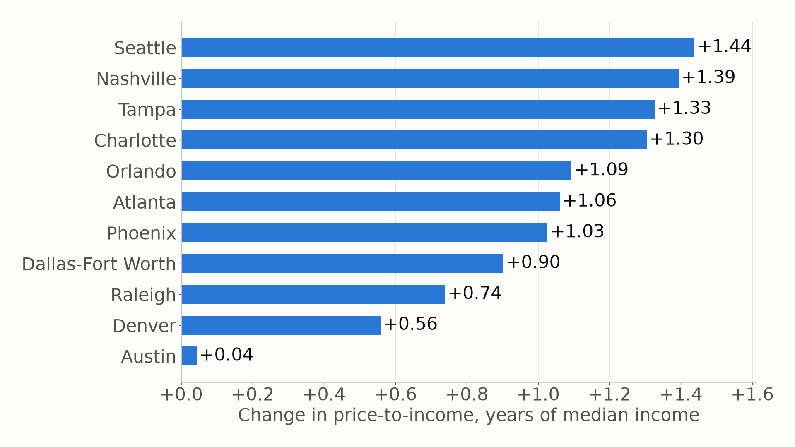
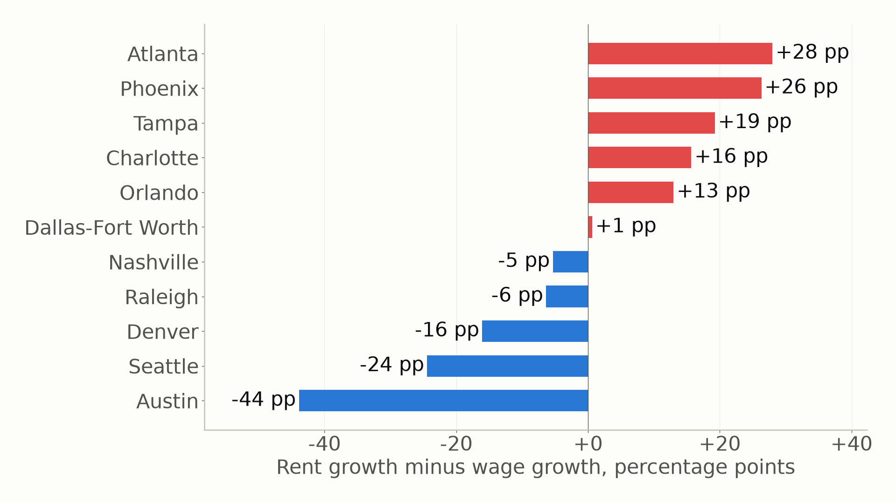
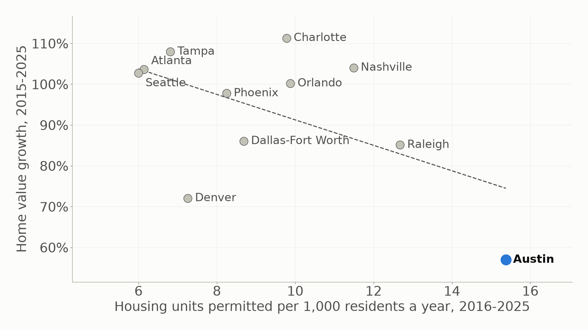

# Priced out: what eleven years of public data say about housing in fast-growing US metros

*Data through September 2026. Every number here is in the [findings log](findings.md) or the
[model card](model_card.md), with its caveats.*

In 2015 the typical home in Seattle cost 4.9 years of the median household's income. Today it costs 6.3. Seattle is
the extreme case, but it is not the exception: in each of the 11 fast-growing metros I tracked, a home now takes more
years of income to buy than it did in 2015.

I wanted to know three things. How much worse did it get, and where? Did the metros that built more housing do
better? And can you see which neighborhoods will jump next before they do? To answer them I built a pipeline that
pulls 11 free public sources every month, from Zillow and Redfin to the Census, the Bureau of Labor Statistics, the
IRS and HUD, and turns them into one tested table per metro-month and per ZIP-month: 1,436 ZIP codes, January 2015 to
September 2026.

## Every metro got less affordable

Price-to-income is the typical home value divided by the median household income. Comparing the 2015 average with
the last 12 months, it rose in all 11 metros. Seattle added 1.44 years of income and Nashville 1.39. Austin added
0.04, because it gave back its whole 2022 spike.

One caveat matters here. The leader depends on where you start counting. Start in 2017 or 2019 and Charlotte rises
most, while Seattle drops to the middle. Austin and Denver stay at the bottom from every start year, though. Income
is also the slowest number in the ratio: the Census 5-year survey trails current incomes by about two years.

## Rents outran pay in six metros

Renters did not escape. From early 2015 to early 2026, asking rents grew faster than average wages in 6 of the 11
metros. Atlanta had the widest gap: rents up 81%, wages up 53%. Austin went the other way, with rents up 34% and wages
up 78%.

Two things soften these numbers. Zillow's rent index tracks asking rents on new leases, which move faster than what
sitting tenants pay. And the wage measure is total pay divided by jobs, so an influx of high-paid jobs lifts it even
if nobody's pay changes. That probably flatters wage growth in Seattle and Austin.

## Austin built its way out, maybe

Austin permitted the most housing of the 11 metros, 15.4 units per 1,000 residents a year from 2016 to 2025, and had
the slowest home value growth, +57%. Across all 11 metros, more permits went with slower growth (r = −0.55).

Then I took Austin out, and the correlation fell to −0.10. One metro carries the whole line. Eleven points are far
too few to call supply the cause, and the arrow can run both ways: metros that draw demand also build more. The honest
reading is that Austin is a striking case, not proof of a rule.

## The hot ZIPs were already rising

The last question was about neighborhoods. Call a ZIP "hot" when its next 12 months of home value growth land in
the top fifth of its metro. A year before they turned hot, those ZIPs were already rising faster than their metro,
by 0.74 standard deviations on average. Picking the top fifth on last year's growth found next year's hot ZIPs 44% of
the time, against a 20% base rate. Hot ZIPs also had lower incomes and cheaper homes than their metro, which is a
reminder that fast price growth often means displacement.

Momentum is not a law, though. It vanished in the January 2021 snapshot and reversed in 2022, when the boom lifted the
ZIPs that had been lagging.

## What the models can and cannot do

I trained two LightGBM models on point-in-time features, meaning each month sees only data that was published by
then. A leakage test checks that rule.

The first forecasts each ZIP's home value growth over the next 12 months. Within a metro it ranks ZIPs better than
any baseline: its error is 1.57 percentage points against 1.74 to 1.78 for the baselines. Overall, it lost. In 2024
and 2025 a plain "no change" guess beat it (2.84 against 3.63), because the market flattened in a way no training
year had, and the model kept forecasting gains.

The second flags likely hot ZIPs. Every model I tried doubled the 20% base rate. LightGBM had the best precision-recall
area (0.342 against 0.301 for momentum), but simple momentum was still more precise on the published
top-fifth-per-metro rule (0.443 against 0.405).

Neither model beats its strongest simple baseline on every measure. So the dashboard shows both as rankings within
a metro, not price targets, and the [model card](model_card.md) says where they fail: regime changes, insurance costs
and zoning, which the data does not have.

## How it is built

- **Ingest:** a Python loader per source writes raw files to bronze Parquet and logs each load. A second run in the
  same month downloads nothing.
- **Transform:** dbt on DuckDB builds 38 models in three layers. 176 data tests guard keys, ranges and joins; the
  hardest part was geography, mapping ZIPs to counties to metros with one documented rule.
- **Learn:** the monthly run refits both models on every known outcome, scores the latest month, logs to MLflow, and
  raises an alert when matured forecasts drift past the backtest's worst error.
- **Ship:** GitHub Actions runs everything on the 20th of each month, keeps the warehouse in Cloudflare R2, and
  publishes the exports and the dbt docs to GitHub Pages, where a Streamlit dashboard reads them.

## What I would do next

The obvious gap is the drivers the data lacks. Insurance costs probably explain the 2024–2025 Florida decline that the
forecast missed, and zoning sits behind the permits story. I would also test the models on metros they have never
seen, and give the forecast a year of flat-market data before trusting its metro-wide level.

The code, the findings log and the model card are on
[GitHub](https://github.com/YearningAsian/metro-housing-affordability). The dashboard runs from the repo with no API
keys. Not investment advice.
